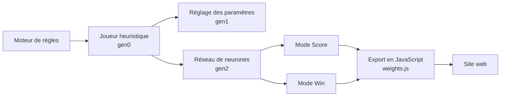

# 🎲 Yahtzee contre un réseau de neurones

Un Yahtzee 1 contre 1 jouable dans le navigateur, face à une IA entraînée en Python puis portée en JavaScript.
Ce dépôt contient le **site** (à jouer) et la **démarche** (pour comprendre comment l'IA a été construite).

👉 **Jouer :** `https://TON-PSEUDO.github.io/NOM-DU-DEPOT/` *(à remplacer par ton lien)*

---

## Sommaire

1. [Jouer](#1-jouer)
2. [Rappel des règles](#2-rappel-des-règles)
3. [L'idée générale](#3-lidée-générale)
4. [Étape 1 : le moteur et le « joueur humain » (heuristique)](#4-étape-1--le-moteur-et-le-joueur-humain-heuristique)
5. [Étape 2 : régler l'heuristique (génération 1)](#5-étape-2--régler-lheuristique-génération-1)
6. [Étape 3 : un réseau de neurones (génération 2)](#6-étape-3--un-réseau-de-neurones-génération-2)
7. [Les deux modes de l'IA : Score et Win](#7-les-deux-modes-de-lia--score-et-win)
8. [Résultats](#8-résultats)
9. [Du Python au navigateur](#9-du-python-au-navigateur)
10. [Reproduire le projet](#10-reproduire-le-projet)
11. [Limites et pistes d'amélioration](#11-limites-et-pistes-damélioration)
12. [Glossaire](#12-glossaire)

---

## 1. Jouer

Ouvre `index.html` (ou le lien GitHub Pages) :

- **Lancer les dés**, puis clique sur un dé pour le **garder** (il se lève avec la mention *GARDÉ*), puis relance (2 relances maximum).
- Les points possibles de chaque case s'affichent en **bleu** dans la feuille de score : clique sur la case voulue pour marquer.
- Quand l'IA joue, elle **annonce ses choix** : les dés qu'elle garde (surlignés), ceux qu'elle relance, puis la case jouée (qui clignote).
- Réglages en haut : adversaire (**IA mode Win** ou **IA mode Score**), qui commence, vitesse de l'IA.

Tout tourne dans ton navigateur : pas de serveur, pas de compte, rien n'est envoyé nulle part.

## 2. Rappel des règles

On joue **13 tours**. À chaque tour : 1 lancer de 5 dés, puis jusqu'à **2 relances** (on choisit les dés à garder), puis on **doit** inscrire le résultat dans une case libre (on met 0 si rien ne convient).

| Partie haute | Partie basse |
|---|---|
| As, Deux, Trois, Quatre, Cinq, Six : somme des dés de cette face | Brelan (3 identiques) : somme des dés |
| **Prime de 35** si la partie haute totalise **≥ 63** (soit 3 dés de chaque face en moyenne) | Carré (4 identiques) : somme des dés |
| | Full : 25 · Petite suite (4 qui se suivent) : 30 · Grande suite (5) : 40 |
| | **Yahtzee** (5 identiques) : 50 · Chance : somme des dés |

**Règle du Joker** (implémentée) : si on fait un Yahtzee alors que la case Yahtzee est déjà remplie, on touche **+100** si elle contient 50 (pas si elle contient 0), et la case est jouée avec ses points complets pour le Full, la Petite et la Grande suite. On doit alors remplir la case haute correspondante si elle est libre.

## 3. L'idée générale

Le but : construire un adversaire qui joue **très bien**, en partant d'un joueur « humain expérimenté » et en l'améliorant par étapes, en **mesurant** chaque progrès.



Une règle a guidé tout le projet : **chaque génération est comparée à la précédente par des matchs** (avec un intervalle de confiance, voir [Résultats](#8-résultats)). Une amélioration qu'on ne mesure pas n'existe pas.

## 4. Étape 1 : le moteur et le « joueur humain » (heuristique)

### 4.1 Le moteur (`yahtzee.py`)

Il y a seulement **252 mains** différentes de 5 dés (si on ne tient pas compte de l'ordre). Le moteur précalcule, pour chacune, les points de chacune des 13 cases. C'est la base de toute la vitesse du projet.

### 4.2 Comment un humain décide

Un bon joueur raisonne en deux temps :

1. **Quels dés garder** pour avoir la meilleure main finale ?
2. **Dans quelle case** inscrire ce résultat ?

La difficulté : la valeur d'une case dépend de la situation (un 18 en Chance gâche une case « facile », un 18 en Six est excellent).

### 4.3 La valeur d'une fin de tour

L'heuristique évalue un résultat avec :

> **valeur = points marqués − valeur moyenne de la case + gestion de la prime (+ bonus Yahtzee)**

- La *valeur moyenne de la case* est le score qu'on obtient en moyenne dans cette case avec un jeu optimal en solitaire (ex. : As ≈ 2,1 ; Six ≈ 19,2 ; Yahtzee ≈ 16,9 ; Chance ≈ 22,0). Marquer 18 en Chance, c'est donc **perdre** 4 points par rapport à la normale ; marquer 18 en Six, c'est en **gagner** presque 0 mais on avance vers la prime.
- La *prime* : un terme récompense les points au-dessus de « 3 dés par face » (la moyenne qui mène à 63) et on ajoute +35 dès qu'on franchit la barre.

### 4.4 Quels dés garder : une programmation dynamique exacte

Plutôt que des règles du pouce, le programme calcule **exactement** la meilleure garde pour la fonction de valeur ci-dessus.

- Il y a 462 « ensembles de dés gardés » possibles (de 0 à 5 dés, sans tenir compte de l'ordre).
- Une matrice `T` donne, pour chaque ensemble gardé, la **probabilité d'obtenir chacune des 252 mains** après avoir relancé les autres dés.
- Avec `W0[main]` = meilleure valeur si on s'arrête sur cette main :

```
E1 = T · W0                      # valeur de chaque garde, s'il reste 1 relance
W1[main] = max sur les gardes de E1
E2 = T · W1                      # valeur de chaque garde, s'il reste 2 relances
```

Ce sont de simples produits matrice-vecteur (rapides avec numpy). Le programme choisit la garde qui maximise la valeur attendue. **Cette mécanique est réutilisée telle quelle par l'IA finale** : seule la fonction de valeur `W0` change.

## 5. Étape 2 : régler l'heuristique (génération 1)

L'heuristique a 3 paramètres (`avg_w`, `k_upper`, `bonus_w`) : le poids de la valeur moyenne des cases, la valeur d'un point au-dessus de la moyenne de la prime, et le poids du bonus de 35.

`gen1_tune.py` les optimise par une **stratégie d'évolution** : à chaque génération on tire 16 variantes autour des paramètres actuels, on garde les 4 meilleures, on recentre dessus et on réduit le bruit. Le critère est le score moyen en solitaire sur des dés communs à tous les candidats (peu bruité et rapide).

**Résultat : un gain minuscule** (51,7 % ± 2,2 contre la version non réglée). L'heuristique était déjà proche de son plafond : le réglage de 3 paramètres ne pouvait pas faire de miracle. Le vrai potentiel était ailleurs.

## 6. Étape 3 : un réseau de neurones (génération 2)

### 6.1 Premier essai (abandonné) : prédire la victoire

Le réseau recevait l'état des deux feuilles de score et prédisait la **probabilité de gagner**, appris en auto-jeu à partir de l'issue des parties (0 ou 1).

**Résultat : un échec** (35 à 45 % de victoires contre l'heuristique, 215 points de moyenne contre 240).

**Pourquoi ?** Une victoire ou une défaite est un signal **très pauvre**. Apprendre qu'un 18 en Chance vaut moins qu'un 18 en Six à partir de « j'ai gagné / j'ai perdu » demande des millions de parties. L'heuristique avait ces connaissances « gratuitement », le réseau devait les redécouvrir avec 24 000 parties. (Le fichier `gen2_train.py` est conservé pour mémoire.)

### 6.2 Deuxième essai (retenu) : prédire le score final attendu

Deux changements ont tout débloqué.

**① Un signal plus riche.** Le réseau apprend à prédire le **score final attendu** d'une feuille de score (un nombre autour de 250, très informatif) plutôt qu'une victoire (0 ou 1). Comme l'adversaire n'influence pas le score attendu de ma feuille, on s'entraîne en **parties solitaires** : deux fois plus rapide, et un meilleur signal.

**② Un point de départ solide : « base + correction ».** On ne demande pas au réseau de tout apprendre :

```
V(feuille) = base(feuille) + 20 × réseau(features)
base       = points déjà marqués + somme des valeurs moyennes des cases encore libres (+ ~20 si la prime est atteignable)
```

Au départ le réseau sort ≈ 0, donc l'IA joue déjà comme l'heuristique ; il n'apprend que la **correction** (les subtilités de la prime, du timing, etc.).

### 6.3 L'architecture

- **Entrée** : 34 nombres décrivant la feuille de score (cases remplies, points normalisés, avancement de la prime, flags Yahtzee…).
- **Réseau** : 34 → 128 → 128 → 1, activation ReLU, écrit en **numpy pur** (pas besoin de PyTorch), avec rétropropagation faite à la main et optimiseur Adam.

### 6.4 L'astuce « afterstate »

Plutôt que d'évaluer l'état *avant* un coup, on évalue la feuille **après** le coup. Pour une main donnée, beaucoup de coups donnent la même feuille ; on ne garde que les ~100 feuilles distinctes (case, points, bonus) : **une évaluation du réseau par tour** au lieu de 252 × 13.

### 6.5 L'apprentissage : TD(λ)

On ne veut pas attendre la fin de la partie pour savoir si un coup était bon. Le **TD(λ)** mélange deux informations : « ce que le réseau pensait après le coup suivant » (apprendre de soi-même) et « le score final réellement obtenu » (la réalité). Avec λ = 0,7, chaque état est entraîné vers un mélange des deux, ce qui réduit fortement le bruit.

Détails : 300 itérations × 200 parties, taux d'apprentissage décroissant (1e-3 → 1e-4, en cosinus), un peu d'exploration aléatoire au début (5 % → 1 % de cases jouées au hasard). Environ **77 minutes** sur un vieux processeur AMD A6.

## 7. Les deux modes de l'IA : Score et Win

Les deux modes utilisent **le même réseau**, seule la décision change.

### Mode Score
Maximise le **score final attendu**. C'est le Yahtzee « solitaire optimal » approché.

### Mode Win
En 1 contre 1, ce qui compte est de **gagner**, pas de marquer le plus. L'idée : estimer la probabilité de victoire à partir de l'écart de score attendu entre les deux joueurs et de l'**incertitude restante** :

$$P(\text{gagner}) \approx \Phi\!\left(\frac{V_{\text{moi}} - V_{\text{adversaire}}}{\sigma}\right), \qquad \sigma = \sqrt{\sigma_{\text{moi}}^2 + \sigma_{\text{adv}}^2}$$

où `V` est le score final attendu donné par le réseau, `Φ` la loi normale, et `σ` dépend du **nombre de tours restants** (une table estimée pendant l'entraînement : plus il reste de tours, plus le résultat est incertain). En théorie, cela doit donner un jeu **prudent quand on mène** et **risqué quand on est mené**.

## 8. Résultats

> Les « ± » sont des **intervalles de confiance à 95 %**. Sur 2000 parties, un taux de victoire est connu à environ ±2,2 points près : une différence de 1 ou 2 points n'est pas significative.

| Joueur | Score moyen en solo | Résultat en 1 contre 1 |
|---|---|---|
| Heuristique de base (gen0) | ≈ 237 | référence |
| Heuristique réglée (gen1) | ≈ 237 | 51,7 % ± 2,2 contre gen0 (quasi identique) |
| Réseau, première tentative (victoire) | — | 35–45 % contre l'heuristique ❌ |
| **Réseau, mode Score** | **246,7** | **58,1 % ± 2,2 contre gen1** (248,7 pts de moyenne contre 236,8) |
| Réseau, mode Win | — | 55,5 % ± 2,2 contre gen1 (244,3 contre 240,1) |

Pour situer : le score moyen **optimal** en solitaire est d'environ **254,6**. Le réseau est à ~8 points de ce plafond théorique.

**Constat honnête :** le mode Win n'a **pas** battu le mode Score contre l'heuristique. Dans mes tests d'un match miroir (Win contre Score), l'avantage était d'environ 2 à 3 points et restait dans la marge d'erreur. Le gain réel vient donc de l'amélioration du jeu « de base », pas de la logique 1 contre 1.

## 9. Du Python au navigateur

Le site est du **JavaScript pur** (aucune dépendance, aucun serveur).

| Fichier | Rôle |
|---|---|
| `index.html`, `style.css` | Page et mise en forme (thème tapis vert, dés dessinés en CSS) |
| `ai.js` | Port JavaScript du moteur, de la programmation dynamique et du réseau |
| `app.js` | Interface : dés, clics, tours de l'IA animés avec ses choix affichés |
| `weights.js` | Les poids du réseau (≈ 180 Ko), générés par `export_weights.py` |

`export_weights.py` lit le fichier `.npz` (poids numpy) et écrit `weights.js` ; la page l'inclut avec une simple balise `<script>`, ce qui marche aussi en ouvrant `index.html` directement (un `fetch()` de fichier JSON serait bloqué par le navigateur en local).

**Fidélité du port :** sur 120 situations aléatoires (garde à 2 relances, garde à 1 relance, choix de la case, dans les deux modes), les décisions du JavaScript sont **identiques** à celles de Python. Le calcul d'un tour par l'IA prend ~4 ms. Un test automatisé a aussi joué des parties complètes dans un navigateur sans erreur.

## 10. Reproduire le projet

Dossier d'entraînement Python (numpy suffit) :

```bash
python3 -m venv .venv && source .venv/bin/activate
pip install numpy

python yahtzee.py                                   # test du moteur
python gen1_tune.py --gens 10 --games 300 --final 2000   # génération 1 → best_params_gen1.json
python gen2b_train.py --iters 300                   # génération 2 → scorenet_best.npz
python match.py scorenet_best.npz:score gen1 2000   # comparer deux joueurs
python match.py scorenet_best.npz:win gen1 2000
python export_weights.py scorenet_best.npz          # → weights.js pour le site
```

`match.py` accepte : `random`, `gen0`, `gen1`, ou un `.npz` (avec `:score` / `:win`).

| Fichier Python | Rôle |
|---|---|
| `yahtzee.py` | Règles, joueur heuristique, arène de matchs |
| `gen1_tune.py` | Génération 1 (réglage par évolution) |
| `netlib.py` | Outils réseau en numpy (Adam, features) |
| `scorenet.py` | Réseau de score attendu, joueur (modes Score et Win) |
| `gen2b_train.py` | Entraînement TD(λ) retenu |
| `gen2_train.py` | Première tentative (réseau de victoire), abandonnée |
| `match.py` | Matchs entre deux joueurs avec intervalle de confiance |
| `humans.py` | Adversaires « humains » simulés (heuristique + erreurs), non utilisés à ce stade |
| `export_weights.py` | Conversion des poids vers `weights.js` |

> **Dépannage (processeur ancien) :** si Python plante avec « Instruction non permise » (*Illegal instruction*) à l'import de numpy, c'est que le numpy de pip exige des instructions que ton CPU n'a pas. Solution sous Debian : `sudo apt install python3-numpy` puis `python3 -m venv --system-site-packages .venv`.

## 11. Limites et pistes d'amélioration

- **Le mode Win n'apporte pas de gain démontré.** Il a été validé techniquement, pas statistiquement.
- **Adversaire « humain » non modélisé.** Le but initial était d'optimiser contre un bon joueur humain, plus faible que l'heuristique. `humans.py` fournit des joueurs avec erreurs (réglés par un paramètre `tau`) mais l'IA n'a pas été entraînée spécifiquement contre eux. Contre un adversaire plus faible, la bonne stratégie est plus prudente.
- **Solveur exact.** Une programmation dynamique complète du Yahtzee solitaire donnerait la stratégie optimale (254,6) : une référence parfaite pour mesurer l'écart du réseau.
- **Entraînement direct sur les matchs.** Ajuster le mode Win à partir de l'issue de vrais matchs, en gardant le réseau de score comme base.

## 12. Glossaire

- **Heuristique** : règle de décision écrite à la main (ici : « points − valeur moyenne de la case », etc.).
- **Programmation dynamique** : décomposer un problème en sous-problèmes dont on mémorise les résultats (ici : la meilleure garde à 1 relance sert à calculer celle à 2 relances).
- **Afterstate (état « après coup »)** : l'état obtenu juste après avoir joué un coup ; plus pratique à évaluer que l'état avant.
- **TD(λ)** (*temporal difference*) : apprendre à prédire une valeur en se corrigeant par rapport à ses propres prédictions suivantes, mélangées au résultat final.
- **MLP** (*multi-layer perceptron*) : réseau de neurones « classique » fait de couches de neurones connectées.
- **Intervalle de confiance à 95 %** : la fourchette dans laquelle se trouve la vraie valeur avec 95 % de chances ; plus on joue de parties, plus elle est étroite.
- **Auto-jeu** : le programme s'entraîne en jouant contre lui-même.

---

## Crédits

- Les valeurs moyennes par case et le plafond de ≈ 254,6 points proviennent des analyses publiées de la stratégie optimale du Yahtzee solitaire (notamment les travaux de Tom Verhoeff).
- Code et démarche construits pas à pas, avec l'aide de Claude (Anthropic).
